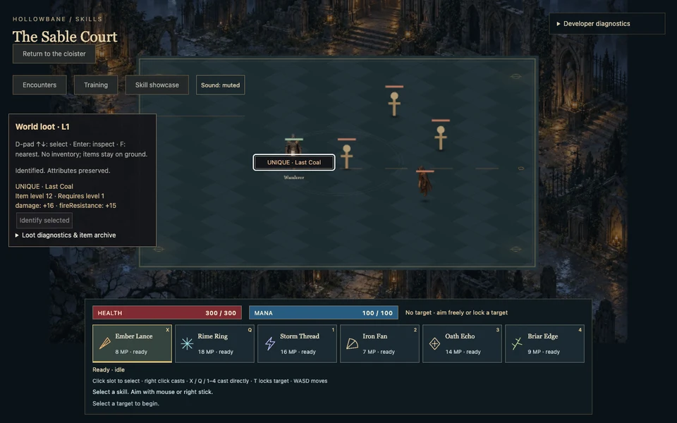

# L1 Item Architecture & Loot

Polish approved; L1 authorized. Scoped DBL-310–317 follow original item/loot requirements. Broad parents remain partial. No full inventory/equipment/progression or L2. All content original.

## DBL-310

Eight original bases across blade/bow/staff/chest/helm/shield/boots/ring; bounded version1 registries, four quality weights, affix groups/exclusions/level gates and two unique templates. Atomic detached validation rejects unsupported/duplicate/nonfinite/dangling content. Full check178 unit tests passes; no runtime behavior changed. Broader equipment parents remain partial.

## DBL-311

Per-roll seed/sequence streams independent of combat; chance3500/10000, quality weights normal8000/magic1700/rare290/unique10. Base effective weight is table weight × intrinsic base weight. Level=max(monster,area)+table modifier clamped1–99. Unique rolls without eligible base template fall back to rare, never upgrade another base. Magic1–2/rare3–4 affix attempts, group/exclusion/directional kind caps; fewer affixes if pool exhausted. Original two unique templates. 10k invariant rolls and full check182 pass.

## DBL-312

Unknown magic/rare/unique labels hide name, requirements and rolled stats until explicit identification; identifying is immutable/idempotent and never rerolls. Version1 bounded256-item/512KiB archive, origin replay validates all attributes and rejects extra fields, duplicates, unsupported versions and malformed/forged data atomically. This is a developer item archive, not inventory/equipment or secure anti-cheat. Full check185 tests.

## DBL-313

Pure death-event adapter consumes each dead non-player ID once, sorts tick/ID, captures corpse position before despawn, never mutates combat RNG. Bounded128 world drops, deterministic ring placement with26 ground-pixel separation and collision validation; capacity/duplicate/blocked placement explicitly counted. Interaction radius110 ground pixels plus existing LOS/navigation. This slice provides the tested adapter; playable scene integration follows314. Full check188 and targeted placement/dedup/range tests pass.

## DBL-314

Playable ?loot=1 (plus &training=1 for dummies): consumes actual combat/skill deaths before corpse despawn; ground triangles/quality names/colors, up to32 collision-spaced viewport labels with selected priority, all128 drops selectable. D-pad up/down, existing Interact or F nearest; left/right still skills. Inspection requires proximity/LOS; identification reveals stable rolls; items stay on ground, no collection/inventory. Contextual saved-binding Xbox/PS prompts. Four original bounded synthesis cues reuse audio mute/cap/fallback. Local versioned developer item archive validates atomically and places near player; it is not a world save. First browser pass found panel overlap, corrected and all5 cases pass (natural death, archive/tamper, Xbox, PS, visual); new1% reference reviewed, prior baselines unchanged. Full check189;15 provenance records. Final regression/cross-browser at316.

## DBL-315

Table diagnostics expose actual effective base weights/eligibility, affix groups/exclusions and expected conditional quality including unique fallback. Seed/sequence replay and explicit example presets0 normal,1 magic,37 rare,35078 unique (seed42, level12). Simulation script `node scripts/loot-report.mjs` validates 1.2million rolls: seeds42/7331/2026 paired across levels1/12/30/99,100k each; drop/base/quality checks use6-sigma+5-count diagnostic bands, not a claim of statistical independence/security. 34,990–35,007 drops per100k; at levels12+10 unique each, level1 none. No invalid attributes/affix combinations; all generated items replay-validate. Detailed distributions/examples/table inspection in distributions.json. Batch generation+replay-validation~0.3sec/100k on this M4, not a gameplay frame-time claim. Full check191 and targeted tests pass. Generated local model ignored by lint/format, not committed.

## DBL-316

Full check191, type/lint/build/assets/backlog/format. All68 previous Chromium scenarios pass; six final L1 cases pass after fixing two test-only ambiguous summary selectors and actual panel overlap found in screenshot review. Controller test explicitly selects between two items, checks no accidental cast; four-label geometry/duplicate identity tested. Original baselines/tolerances unchanged; new1% L1 reference intentionally updated for panel below navigation. Unmasked showcase.webp reviewed, actual seed42/sequence35078 level12 Last Coal identified, not a natural-drop frequency illustration. One accidentally concurrent build/test start was aborted and rebuilt before all final six cases were rerun against a stable preview. Final browser checks include a real hostile-monster death, not only a dummy; final-layout cross-browser reconfirmation follows before317. Firefox caught a1px fixed-height navigation overlap; panel now measures actual navigation height and fits available space above HUD. Repeated performance/publication is split into317, final gate318. Label styles update only when changed; hover highlight does not reorder selection.

Final adaptive layout: actual hostile death passes Chromium plus all10 final Firefox/WebKit cases; navigation-spacing and label-overlap assertions pass in all three browsers. Reference/capture refreshed and inspected. Existing simulation/combat/AI/locomotion/package manifests have no diff from approved polish; only the scene adapter and new independent item modules are added.

## DBL-319 required RNG correction (supersedes initial v1 distributions/examples)

Burst profiling exposed a flaw missed by long-stream marginal tests: first30 rolls across adjacent seeds0–999 yielded only6858/30000 drops and29 distinct patterns. Avalanche mixing of seed/counter before LCG expansion now gives10488/30000 and1000 distinct patterns. The regression test fails the old implementation and passes the correction; detailed pre/post data early-seed-regression.json. Loot remains isolated from combat RNG. Maximum sequence rollover advances the seed deterministically; valid extreme archived counters cannot crash a later death.

**Content version2**, save/item schema1. Generator changes require content versioning: older prototype content1 archives are rejected clearly, never silently rerolled. Stable IDs include content version, seed and sequence. No migration of unreleased v1 prototypes. Current seed42/level12 example rolls: **3 normal Woven Coat;30 magic Warded Woven Coat;47 rare Emberward Trail Boots of Vigor of Clarity;5634 unique Last Coal**. Prior section315 examples are historical v1 and superseded here. Developer presets/report/capture script updated; unique screenshot appearance is unchanged because its fixed template is unchanged.

Current distributions.json replaces the initial report:1.2million rolls, all items replay-validated and all drop/base/quality diagnostic bands pass. Per100k 34894–35132 drops; levels12+7/9/11 uniques for the three seeds, level1 none. Burst timing alone is not a randomness test; the new first-encounter regression explicitly covers that gap. Full check194; V2 six Chromium/ten Firefox-WebKit cases pass. Original core gameplay and breakpoints remain unchanged. Backlog validation now follows actual dependency edges rather than requiring ID order:317 depends on later-discovered319 without renumbering anything; injected cycle correctly rejected. Final317 profiling/publication must use corrected runtime, not earlier a4a15b6.

DBL-317 visual publication follow-up: CI a4a15b6 passed73/74; only new L1 screenshot differed (13,829 pixels). Public Linux actual/diff were retrieved and visually reviewed: native font metrics changed header-mask width and inspector text/height, plus small idle pose differences. A dedicated reviewed Linux L1 baseline uses that actual scene; Darwin keeps its existing baseline. Both retain1% tolerance and the same masks. No old combat/controller/skills/polish reference is changed or relaxed. Earlier bfea4f5 failures were the corrected nested-summary selector issue. Final CI must rerun the corrected V2 runtime with the platform-specific L1 reference.

## DBL-317 corrected-runtime performance

Runtime d3179c4/content2, two interleaved repeats of four-second windows after two-second warmup; same polish camera,1920x1080 viewport/balanced960x540, diagnostics open, muted, durable enemies/immortal player. Before has existing polish, after adds L1; extra loot30 case explicitly preloads30 deterministic items at30 enemies. No other local test browser or CPU simulation benchmark ran during sampling. Full data performance-chromium.json.

| Enemies | Before frame p95, two runs | L1 frame p95, two runs |
| ------: | -------------------------: | ---------------------: |
|       5 |                 16.8, 33.3 |             33.3, 33.4 |
|      10 |                 33.3, 33.4 |             33.4, 33.4 |
|      20 |                 33.3, 33.4 |             33.4, 33.4 |
|      30 |                 33.4, 33.4 |             33.4, 33.4 |

All p50s16.7ms. At30 enemies+30 items, both p95s33.4ms. Loot view CPU p95~0.3–0.5ms per ten-Hz update; event scan CPU typically below0.1ms clock granularity. Combat+AI CPU p95~0.2/0.2/0.4/0.4ms by count, render command CPU~0.3–0.5ms, existing view bucket~0.4–0.8ms. These rolling buckets are partial and the old view bucket excludes the separately measured loot DOM update; they are not an exhaustive main-thread or GPU breakdown. All108/108 virtual skill activations registered, zero missed/page errors/entity drift. Input-to-observed-start p95 varies16.7–33.4ms across runs, not physical controller/damage/display latency.

**Remaining presentation limitation:** the five-enemy L1 pair is33.3/33.4ms versus baseline16.8/33.3; L1 can cross the known software presentation threshold earlier. At10–30 both variants mostly33.3–33.4. No stable60FPS or no-render-regression claim; tiny CPU cost does not prove cheap GPU/compositor presentation. Different earlier v1 timing is not pooled with corrected final data. SwiftShader is explicit; no native-GPU, Firefox-native performance or long-duration claim. Existing broad software/full-detail/native performance follow-ups remain open.

Actual30-death CPU burst benchmark:50 warmup +1000 actual encounters/seeds50–1049, generation/dedup/collision placement timed separately from setup. 30,000 attempts give10,521 drops, zero placement failures; p50~0.022ms, p95~0.043ms, max~0.153ms on Node/M4 (burst-performance.json). This is simulation-only Node CPU, not browser renderer cost. It also motivated the separate early-seed randomness regression; timing alone does not validate distribution.

Benchmark tools: scripts/loot-benchmark.mjs and loot-burst-benchmark.mjs. Publication/hosted checks follow the platform-specific-reference CI checkpoint; source gameplay remains d3179c4.
