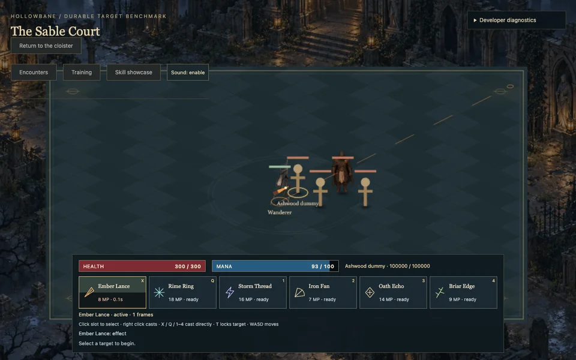
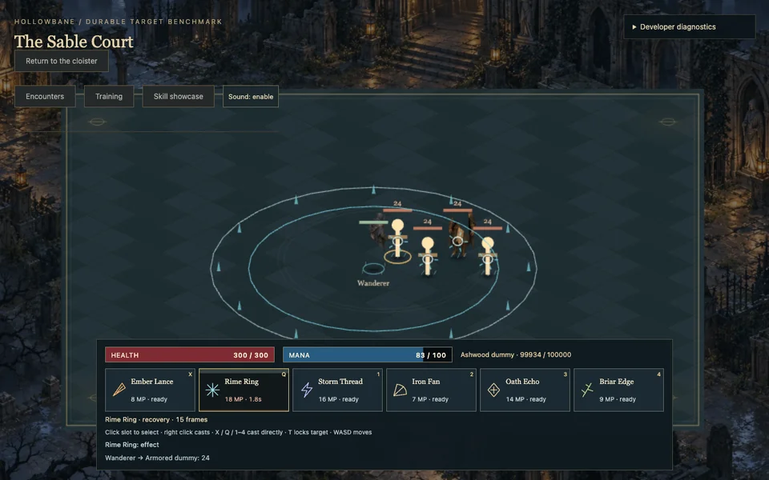
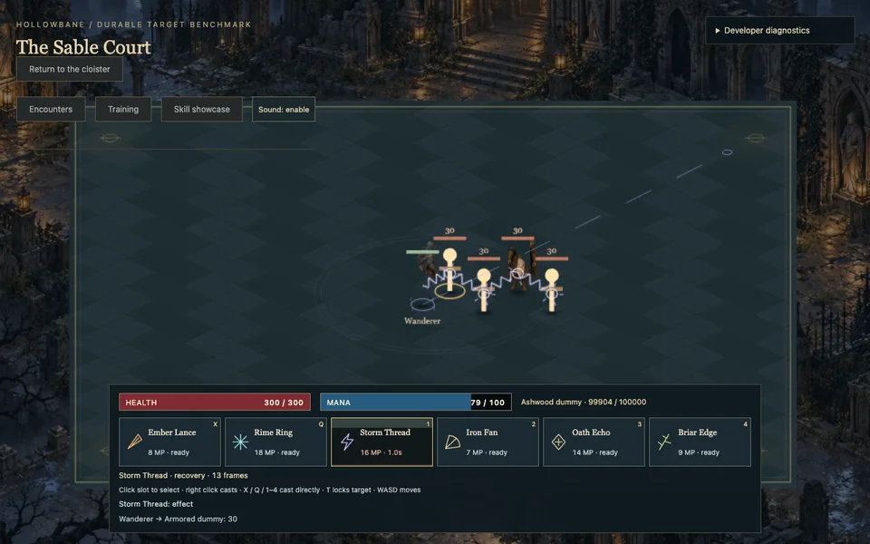
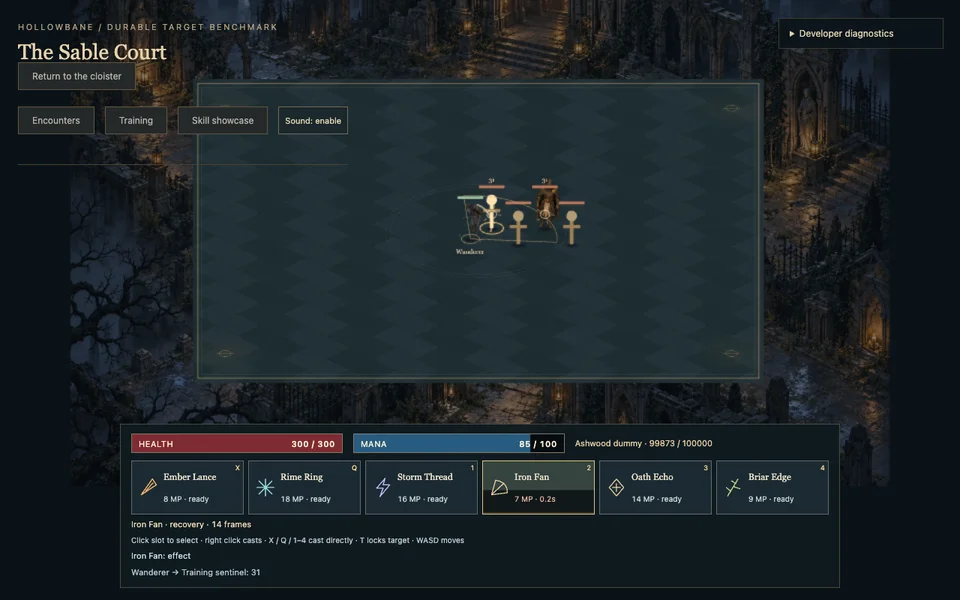
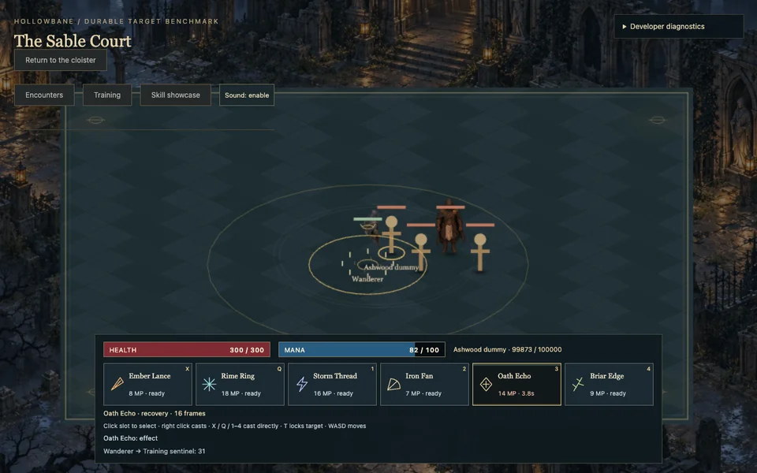
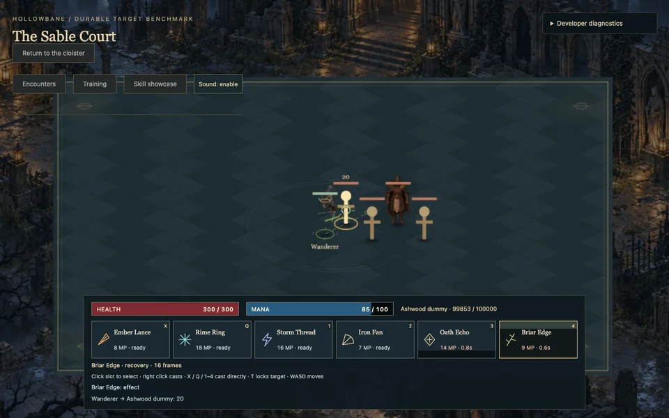

# Skill animation showcase

Live actual-simulation showcase: https://tobisen.github.io/hollowbane/?polish=1&showcase=1 . Real costs, cooldowns and cast/recovery frames; durable training targets and idle AI are explicit developer fixtures. Click Sound to enable synthesized effects.

These are intentional review captures from the original project scene, generated by scripts/polish-showcase.mjs. Ember is frozen at release/in-flight, other captures at least four ticks after their effect event; HUD is allowed to reflect the frozen phase. No visual state was injected. Rendered at 1280x800, downscaled to 960x600 WebP for documentation. Atlas provenance remains ASSET_MANIFEST.md; these are not new third-party art.

## ember-lance

Tick 40; effect tick 40; active.

## rime-ring

Tick 229; effect tick 222; recovery.

## storm-thread

Tick 406; effect tick 402; recovery.

## iron-fan

Tick 587; effect tick 582; recovery.

## oath-echo

Tick 764; effect tick 760; recovery.

## briar-edge

Tick 944; effect tick 940; recovery.

